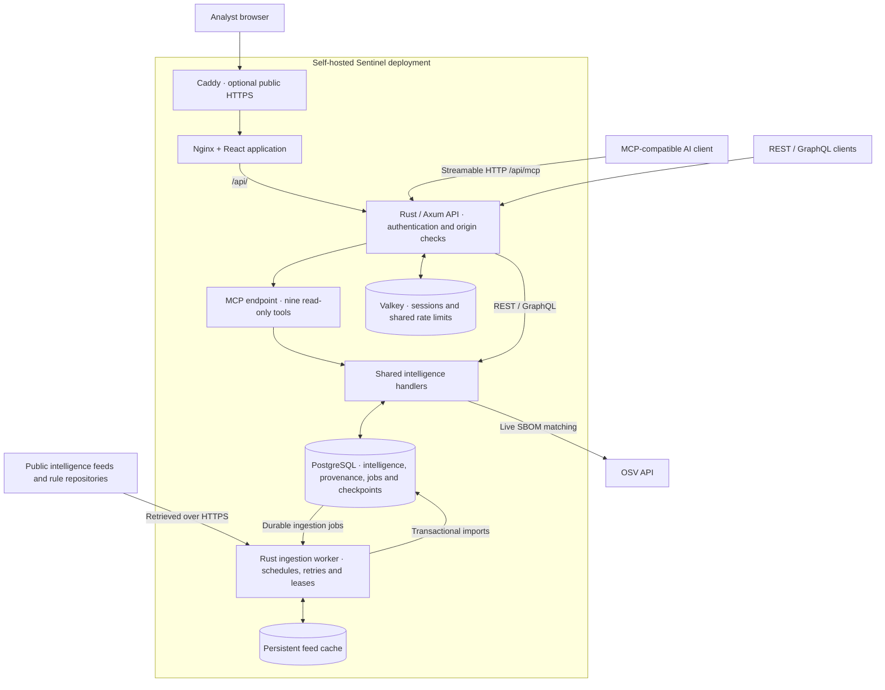

# Sentinel Intelligence

**Self-hosted vulnerability intelligence, with the evidence behind every finding.**

Sentinel brings public vulnerability feeds, exploit signals, threat actor profiles, package advisories, and remediation evidence into one searchable workspace. Use the web app to investigate a CVE, prioritize known exploitation, analyze an SBOM, or trace a patch. Connect the same intelligence to your own tools through REST, GraphQL, or MCP.

Built with **Rust · Axum · React · TypeScript · PostgreSQL · Valkey**. No paid service or model provider is required. Imported data remains subject to its upstream terms and attribution requirements.

[Watch the demo](#demo-walkthrough) · [Get started](#quick-start) · [Architecture](#architecture) · [Connect an AI](#mcp-for-ai-clients) · [Contribute](CONTRIBUTING.md) · [Roadmap](ROADMAP.md)

## Demo walkthrough

[](docs/videos/sentinel-walkthrough.mp4)

**[Watch the walkthrough (MP4 · 1 min 52 sec)](docs/videos/sentinel-walkthrough.mp4)** — click the preview above to open the video.

The silent recording walks through the intelligence overview, searches for CVE-2021-44228 and opens its evidence, explores the MITRE ATT&CK APT28 profile, submits the built-in sample SBOM for analysis, and checks data-source freshness. SBOM results depend on live OSV access and are not shown in this recording.

*Real app captures with ingested public-source intelligence, recorded on 16 October 2026. Counts and source status are snapshots of that installation; a new installation starts empty. See the [recording notes](docs/videos/README.md).*

## What you can do

| Workflow | What Sentinel provides |
|---|---|
| Investigate vulnerabilities | CVE and PURL search, typed filters, facets, cursor pagination, and source evidence |
| Prioritize work | Source CVSS and EPSS, known exploitation, ransomware signals, and an explainable additive priority score |
| Explore adversaries | MITRE ATT&CK profiles, techniques and relationships, plus source-backed ransomware profiles |
| Find remediation | Affected packages, source-supplied CPE/PURL coordinates, fixed versions, and Microsoft KB supersedence lookup |
| Analyze a software inventory | CycloneDX / SPDX JSON analysis using exact versioned PURLs and live OSV matching |
| Record applicability | Validated, persisted OpenVEX statements with audit records; unsigned statements do not suppress findings by default |
| Connect other tools | Authenticated REST, GraphQL, OpenAPI, NDJSON exports, paginated STIX objects, and nine read-only MCP tools |
| Operate your own instance | Continuous ingestion, visible source failures, durable jobs, Docker Compose, and an optional HTTPS proxy |

Missing scores, dates, attribution, and remediation stay unknown. A missing finding is not evidence that a product is safe. Saved views and watchlists are local to your browser.

New to the workspace? Choose **Start tour** in the welcome invitation or **User tour** in the header for an eight-screen introduction. Dismissal is saved in this browser, and the guide can be replayed anytime. Starting it changes screens, so save any in-progress form input first. See [user tour behavior](docs/user-tour.md).

<details>
<summary>More screenshots: threat actors and the SBOM workbench</summary>

### Threat actor investigation


### SBOM and OpenVEX workbench


These are real application captures. They illustrate the interface, not a bundled demonstration dataset or a coverage guarantee.

</details>

## Quick start

### Prerequisites

- Docker with the Compose plugin; Docker must be running.
- Node.js **22.12+ or 24** and npm.
- Rust **1.92+** with Cargo.
- Internet access to retrieve public intelligence feeds.

From your local checkout:

```sh
npm --prefix frontend ci
npm run setup
npm run dev
```

Open **[localhost:5173/vi](http://localhost:5173/vi)**. Sign in using `VI_API_TOKEN` from the generated `.env` file. Setup creates secrets, starts PostgreSQL and Valkey, and provisions a restricted application database role. Do not commit or share `.env`.

The dev launcher starts the API, ingestion worker, and frontend together. Press `Ctrl+C` to stop those processes; the database and Valkey containers remain available. Browser sessions use HttpOnly, SameSite=Strict cookies; the operator token is not saved in browser localStorage.

| Local service | Address |
|---|---|
| Web app | `http://localhost:5173/vi` |
| API | `http://localhost:8080/api/` |
| API reference | `http://localhost:8080/scalar` |
| MCP | `http://127.0.0.1:8080/api/mcp` |
| PostgreSQL / Valkey | Loopback ports `5433` / `6380` |

**The database starts empty.** Ingestion populates it asynchronously, and historical imports take time. Check **Data sources** for progress and upstream failures. To run a source once or inspect committed counts:

```sh
node scripts/run-worker.mjs --once --source 'CISA KEV'
node scripts/status.mjs
```

## Architecture



PostgreSQL is the source of truth, including SQL full-text search, typed filters, and keyset pagination. The independent worker imports source documents, normalizes records, and commits data with provenance and checkpoints. The API sees committed changes immediately. A Tantivy search crate exists, but the current catalog query path uses PostgreSQL.

The worker schedules up to four sources concurrently, persists backoff and leases, caches conditional HTTP responses, and bounds document sizes. It stores detection references without executing downloaded rules. Valkey holds sessions and distributed quotas. The stdio MCP bridge forwards to the same HTTP endpoint; it does not run a second database or start the app.

For development, Vite proxies API requests directly to Axum. For container deployments, Nginx serves the app and proxies the API; the production overlay adds Caddy for TLS. PostgreSQL and Valkey stay on the private Compose network.

## Intelligence sources

| Source | Imported evidence |
|---|---|
| CISA KEV | Known exploitation, dates added/due, and ransomware evidence |
| NIST NVD | CVE descriptions, source CVSS vectors, CPEs, CWE mappings, and explicitly tagged patch links |
| CVE List V5 | Direct CNA/ADP assertions, source scores, affected structures and published/rejected record status; recent incremental coverage |
| Debian Security Tracker / Ubuntu USN | Distribution/release-scoped package remediation; Ubuntu associations retain notice-level scope |
| Trickest CVE index | Unverified community PoC/research references for the ingested catalog; no code execution |
| MITRE CWE | Weakness definitions, upstream mitigations, and classification metadata |
| OWASP Top 10:2025 | Risk categories and explicit CWE mappings from the official documents |
| FIRST EPSS | Exploit probability enrichment for ingested CVEs |
| MITRE ATT&CK | Enterprise groups, techniques, and source relationships |
| RansomLook | Public ransomware group catalog |
| OSV / GitHub Advisory Database | Advisory records, affected package ranges, and fixes |
| CISA Vulnrichment | Source assessments and enrichment for existing CVEs |
| Microsoft MSRC | Recent security updates, KB/product mappings, and source-supplied supersedence |
| Apache HTTP Server | HTML advisories for 2.4 with release status and affected-version evidence |
| Apache Tomcat | HTML advisories for 9.x, 10.x, and 11.x with branch-scoped fixes and commit links |
| OpenSSL | HTML advisories with affected ranges, source severity, and fix references |
| curl / libcurl | Official advisory JSON with affected/fixed events and fix commits |
| Nuclei / Sigma / Suricata | Detection artifacts explicitly mapped to CVEs |
| Vendor CSAF / OpenVEX | Local imports; configuration and a publisher verification process are required |

Records preserve upstream URLs, retrieval timestamps, and document hashes. Optional `NVD_API_KEY` and `GITHUB_TOKEN` credentials improve quotas. NVD starts with a recent 30-day modified window by default; configure `VI_NVD_START` before the first import to begin historical backfill. Counts and source status do not imply a complete historical corpus.

CVE responses include `weaknesses`, `weakness_evidence`, `patch_links`, and product-scoped `remediation_evidence`. Vendor scrapers refresh daily from fixed official URLs; they do not follow arbitrary advisory links. Read definitions with `/api/knowledge/CWE-79` or `/api/knowledge/OWASP-A01:2025`; existing relationship endpoints connect CVEs → CWEs → OWASP categories. Knowledge is context, not evidence that a specific product is affected or fixed. See the [source expansion plan](docs/data-source-expansion.md).

The CVE drawer’s **Evidence** tab shows publisher and collection dates separately, release-scoped remediation, and unverified community references. New collectors have explicit incremental and historical coverage limits; see the [expansion plan](docs/intelligence-expansion-plan.md) and [source operations](OPERATIONS.md#direct-cve-records-distribution-fixes-and-poc-references).

See [source attribution and upstream terms](SOURCES.md). The project license does not relicense imported feeds, advisory text, rule contents, or third-party dependencies.

## API and exports

The API accepts the operator bearer token, a scoped client bearer credential, or an authenticated browser session. A self-hosted API reference is available at `/scalar`, with OpenAPI at `/api-docs/openapi.json`; it loads no CDN scripts. See [security upgrade and scoped client setup](OPERATIONS.md#security-upgrade-and-scoped-clients).

With `VI_API_TOKEN` already set in your shell:

```sh
curl http://localhost:8080/api/v2/vulnerabilities/filter \
  -H "Authorization: Bearer $VI_API_TOKEN" \
  -H 'Content-Type: application/json' \
  -d '{"text_search":"log4j","limit":10}'

curl http://localhost:8080/api/graphql \
  -H "Authorization: Bearer $VI_API_TOKEN" \
  -H 'Content-Type: application/json' \
  -d '{"query":"{ vulnerabilities(search: \"log4j\", limit: 10) }"}'
```

- `/api/download/latest` streams the catalog as NDJSON using bounded database pages. The UI’s filtered export preserves the current search constraints.
- `/api/v21/collections/sentinel/objects/` returns paginated STIX vulnerability objects. Full TAXII conformance is not implemented.
- `/health` checks process liveness; `/readyz` checks PostgreSQL and Valkey; authenticated `/api/metrics` exposes Prometheus text metrics.

SBOM analysis requires upstream OSV access. Unknown or unversioned components produce warnings. `VI_TRUST_LOCAL_VEX=true` is an explicit trust policy for local statements, not publisher signature verification. Missing score inputs contribute zero and remain disclosed; SSVC stays Unassessed unless a source supplies a decision.

## MCP for AI clients

Connect an MCP client to `http://127.0.0.1:8080/api/mcp` and supply `Authorization: Bearer <SCOPED_CLIENT_TOKEN>` using an expiring `read` credential. Keep `npm run dev` running for local development. The **API & integrations** screen provides copyable configuration. If initialization reports `connection refused`, start Sentinel and reconnect the client; running only the database and Valkey containers is insufficient. See [MCP troubleshooting](MCP.md#connection-troubleshooting).

Nine read-only tools cover vulnerability search, CVE evidence, detection rules, relationships, actor and product search, KB lookup, dataset statistics, and source status. A Node stdio bridge supports clients that launch a local process:

```text
node /absolute/path/to/threat-intel/scripts/mcp-stdio.mjs
```

Set `VI_MCP_URL` and `VI_API_TOKEN` in the client environment. Supported protocol revisions are `2025-03-26`, `2025-06-18`, and `2025-11-25`. Remote clients need a reachable HTTPS deployment. OAuth-only clients require an authentication gateway; the operator token remains an administrator credential; use a scoped client key for integrations.

See [MCP setup, tools, and compatibility](MCP.md).

## Deployment

Stop the dev launcher first to free API port 8080, then:

```sh
npm run setup
docker compose up -d --build
```

Open **[localhost:3000/vi](http://localhost:3000/vi)**. App containers use non-root users, read-only root filesystems, dropped capabilities, and a restricted database account. Feed caches and database storage use persistent volumes.

For public HTTPS, configure DNS and `VI_PUBLIC_HOST` in `.env`:

```sh
docker compose -f compose.yaml -f compose.production.yaml up -d --build
```

Caddy obtains TLS certificates and proxies the frontend. Production uses Secure session cookies and requires a strong operator recovery token, PostgreSQL, and Valkey. Optional OIDC SSO supports locally assigned reader, analyst, auditor and administrator roles. The **Audit & access** screen manages approvals, activity history and SSO session revocation. Verified PostgreSQL TLS is available for remote databases. See [identity, audit and database TLS setup](OPERATIONS.md#database-tls-oidc-sign-in-and-audit-management). Tenant isolation and high availability are not implemented.

Read [Operations](OPERATIONS.md) for backups, restores, credential rotation, monitoring, and source troubleshooting. `docker compose down` retains volumes; adding `--volumes` deletes stored data.

## Development and verification

```sh
# Rust and frontend unit tests
npm test

# Formatting and build checks
cargo fmt --manifest-path backend/Cargo.toml --all --check
cargo build --manifest-path backend/Cargo.toml --locked
npm run build

# PostgreSQL / Valkey integration tests; run setup first
node scripts/test-production.mjs

# Optional: requires an ingested catalog and upstream access
node scripts/test-live.mjs
```

The integration suite creates and removes a disposable PostgreSQL database. It checks authentication, sessions, origin rejection, typed filters, cursor pagination, jobs, VEX validation/persistence, exports, GraphQL, MCP, and restart persistence. It does not populate your application database with synthetic intelligence. GitHub Actions runs the unit tests, builds, and production integration suite.

```text
backend/crates/
  vi-api/       Axum routes, authentication, GraphQL, OpenAPI and MCP
  vi-core/      Shared models, scoring and evidence merging
  vi-db/        PostgreSQL persistence, filters, jobs and checkpoints
  vi-ingest/    Feed adapters and continuous worker
  vi-search/    Tantivy search implementation; not the catalog query path
frontend/       React workspace, analysis tools and frontend tests
scripts/        Setup, launch, verification, backup and stdio MCP bridge
deploy/         PostgreSQL role provisioning and Caddy configuration
docs/images/    Real app screenshots used in this README
```

## Project status and contributing

Sentinel is under active development. The included deployment and verification work does not constitute a security certification or a guarantee of corpus completeness. Signed publisher VEX, broader historical coverage, full TAXII, tenant isolation, and capacity testing remain on the [roadmap](ROADMAP.md). See the [implementation record](IMPLEMENTATION.md) for detailed scope.

Contributions to adapters, evidence quality, tests, accessibility, documentation, and operations are welcome. Start with [CONTRIBUTING.md](CONTRIBUTING.md), follow the [Code of Conduct](CODE_OF_CONDUCT.md), and use the issue and pull request templates. For vulnerabilities in Sentinel itself, follow [SECURITY.md](SECURITY.md) instead of posting exploit details publicly.

## License and acknowledgments

Sentinel source code is available under the [GNU General Public License v3.0](LICENSE) (`GPL-3.0-only`). Upstream data and dependencies retain their own licenses; see [SOURCES.md](SOURCES.md). Thanks to the public intelligence projects and open-source maintainers whose work makes this application possible.
